# Reporte de referencia: WOA (algoritmo de la ballena)

> **Para qué es este archivo.** Es una guía con todo el contenido que
> necesita el reporte, en el orden que pidió el profe y explicado en
> palabras sencillas. **No es para entregarse tal cual**: el profe evalúa el
> escrito, así que úsenlo para entender y luego escriban el reporte con sus
> propias palabras y en un tono más formal. Los números salen de la carpeta
> `resultados/` (30 corridas por configuración, salvo la Tabla 1 de 25
> ejecuciones, que es 1 corrida por fila).

Secciones que pide el profe: **Portada · Introducción · Desarrollo ·
Experimentación · Resultados · Conclusiones · Bibliografía**. Él dijo que lo
más importante es **la discusión de los resultados**, así que en
Resultados no basta con poner números: hay que explicar **por qué** pasa
cada cosa.

---

## Portada

Lo normal:

- Nombre de la universidad, carrera y materia.
- Título, por ejemplo: *"Optimización de funciones de prueba con el
  algoritmo de la ballena (WOA)"*.
- Nombres: Paola y Diana.
- Profesor y fecha.

---

## 1. Introducción

**La idea en corto:** queremos que la compu encuentre el punto más bajo de
una función matemática.

### ¿Qué es optimizar?

Imagina un terreno lleno de cerros y hoyos, y tienes que encontrar el punto
más bajo **con los ojos vendados**. Solo puedes pararte en un lugar y
preguntar "¿a qué altura estoy?". Eso es optimizar: probar puntos y quedarte
con el más bajo. El problema es que el terreno puede tener muchos hoyos
pequeños (**mínimos locales**) que te engañan y te hacen creer que ya
llegaste al fondo, cuando el hoyo más profundo (**mínimo global**) está en
otro lado.

### ¿Por qué un algoritmo "inspirado en la naturaleza"?

Hay métodos que, en lugar de una sola persona con los ojos vendados, mandan
**a un grupo** a buscar al mismo tiempo, y se van pasando información de
quién va mejor. Se llaman **metaheurísticas**. Muchas se inspiran en
animales: hormigas, abejas, lobos... y ballenas.

### ¿Por qué ballenas?

Las ballenas jorobadas tienen una técnica de caza muy curiosa: nadan en
**espiral** alrededor de un banco de peces soltando burbujas. Las burbujas
forman una "red" que encierra a los peces, y luego suben a comérselos. Seyedali
Mirjalili y Andrew Lewis convirtieron ese comportamiento en un algoritmo en
2016: el **Whale Optimization Algorithm (WOA)**.

### ¿Qué hicimos?

1. Programamos WOA en Python.
2. Lo usamos para resolver las **primeras 5 funciones de prueba** de la
   página de Wikipedia *"Test functions for optimization"*: Rastrigin,
   Ackley, Sphere, Rosenbrock y Beale.
3. Hicimos experimentos cambiando sus parámetros (cuántas ballenas, cuántas
   vueltas, etc.) para ver **qué efecto tiene cada uno** en el resultado.

---

## 2. Desarrollo

### 2.1 Cómo funciona WOA

**Los personajes:**

- Cada **ballena** es una posible respuesta (un punto en el terreno).
- La **presa** es la mejor respuesta encontrada hasta ahora. Todas las
  ballenas la usan de referencia.

**El ciclo:** al principio las ballenas aparecen en lugares al azar. Luego,
en cada vuelta (iteración), cada ballena se mueve de **una de tres maneras**:

| Manera | Qué hace | ¿Explora o explota? |
|---|---|---|
| **Rodear la presa** | Se acerca a la mejor respuesta conocida. | Explota |
| **Buscar otra presa** | En lugar de ir hacia la mejor, va hacia **otra ballena al azar** y puede pasarse de largo. Así descubre zonas nuevas. | Explora |
| **Espiral** | Se mueve alrededor de la presa, a veces de un lado y a veces del otro, como la red de burbujas. | Explota |

Después de que todas se mueven, se revisa si alguna encontró un punto más
bajo que la presa. Si sí, esa se vuelve la nueva presa. Y se repite.

**Explorar vs. explotar (la idea más importante del reporte):**

Imagina que llegas a una ciudad nueva y buscas el mejor lugar para comer.
Los primeros días **exploras**: caminas por todos lados probando cosas
distintas. Ya que encontraste una buena zona, **explotas**: te quedas por
ahí probando los lugares cercanos. Si exploras demasiado, nunca aprovechas lo
que encontraste. Si explotas demasiado pronto, te quedas con el primer lugar
"más o menos" y nunca encuentras el mejor.

WOA hace exactamente eso con un número llamado **`a`**, que funciona como
reloj:

- Al inicio `a = 2`, y las ballenas exploran mucho (salen las búsquedas al
  azar).
- `a` va bajando poco a poco hasta llegar a 0.
- Al final las ballenas casi solo explotan: se quedan cerca de la presa
  afinando la respuesta.

**¿Cómo decide cada ballena qué hacer?** Con dos "volados":

1. Un número al azar `p` entre 0 y 1. Si sale menor que 0.5 → rodear o
   buscar. Si sale mayor → espiral.
2. Si toca rodear o buscar, se mira otro número, `A`, que depende de `a`. Si
   `A` es "chico" (entre -1 y 1) → rodear. Si es "grande" → buscar. Como `a`
   va bajando, `A` cada vez sale más chico, y por eso al final ya casi no hay
   búsquedas.

**Las fórmulas** (para el reporte sí hay que ponerlas):

| Qué | Fórmula |
|---|---|
| El reloj | `a = 2 (1 - t/T)` (t = vuelta actual, T = total de vueltas) |
| Números de cada ballena | `A = 2·a·r1 - a`,  `C = 2·r2`  (r1, r2 al azar entre 0 y 1) |
| Rodear la presa | `X_nueva = X* - A·\|C·X* - X\|` |
| Buscar otra presa | `X_nueva = X_rand - A·\|C·X_rand - X\|` |
| Espiral | `X_nueva = \|X* - X\|·e^(b·l)·cos(2πl) + X*` (l al azar entre -1 y 1) |

Donde `X` es la ballena, `X*` la presa y `X_rand` una ballena al azar.
`|...|` es la distancia entre la ballena y a quien sigue.

**Pseudocódigo** (versión sencilla):

```
poner N ballenas al azar dentro del dominio
presa = la mejor de todas
repetir T veces:
    a = 2 * (1 - vuelta / T)
    para cada ballena:
        sacar r1, r2, p, l al azar
        A = 2*a*r1 - a ;  C = 2*r2
        si p < 0.5:
            si |A| < 1:  rodear la presa
            si no:       buscar hacia una ballena al azar
        si no:
            moverse en espiral alrededor de la presa
    regresar al dominio a las ballenas que se salieron
    si alguna ballena es mejor que la presa, ahora ella es la presa
devolver la presa
```

**Un detalle curioso para mencionar:** aunque se llama "espiral", en las
fórmulas el movimiento en realidad cae sobre una **línea recta** que pasa
por la presa (porque `l` es un solo número para todas las coordenadas). La
"espiral" está en cómo oscila la distancia. Se ve clarito en la pestaña
*Paso a paso* de la app.

### 2.2 Las 5 funciones de prueba

Son funciones famosas que se usan para "poner a prueba" algoritmos de
optimización. Cada una tiene una trampa distinta. En todas, el valor más
bajo posible es **0**.

**1. Rastrigin: el cartón de huevo.**
Tiene forma de tazón, pero toda la superficie está llena de hoyitos
(muchísimos mínimos locales). Es fácil quedarse atorado en un hoyito que no
es el bueno.
`f(x) = 10n + Σ [x_i² - 10·cos(2π·x_i)]` · Dominio: -5.12 a 5.12 · Mínimo en
(0, ..., 0) · Se puede usar con cualquier número de variables; usamos 10.

**2. Ackley: la llanura con un pozo.**
Casi toda la superficie es plana y con ondulaciones, y en el centro hay un
pozo profundo. En la parte plana no hay "pistas" de hacia dónde ir.
`f(x,y) = -20·e^(-0.2·√(0.5(x²+y²))) - e^(0.5(cos 2πx + cos 2πy)) + e + 20`
· Dominio: -5 a 5 · Mínimo en (0, 0) · 2 variables.

**3. Sphere: el tazón.**
La más fácil: un tazón perfecto, sin trampas. Sirve para ver si el algoritmo
funciona en lo básico y qué tan rápido llega.
`f(x) = Σ x_i²` · Dominio: -100 a 100 (lo elegimos nosotras) · Mínimo en
(0, ..., 0) · Usamos 10 variables.

**4. Rosenbrock: el valle del plátano.**
El mínimo está al fondo de un valle largo, angosto y curvo (forma de
plátano). Llegar al valle es fácil, pero avanzar por él hasta el punto
exacto es muy lento porque el fondo es casi plano.
`f(x) = Σ [100(x_{i+1} - x_i²)² + (1 - x_i)²]` · Dominio: -30 a 30 (lo
elegimos nosotras) · Mínimo en **(1, ..., 1)** · Usamos 10 variables.

**5. Beale: los valles angostos.**
Tiene valles estrechos y esquinas muy empinadas, con algunos mínimos locales.
`f(x,y) = (1.5 - x + xy)² + (2.25 - x + xy²)² + (2.625 - x + xy³)²` ·
Dominio: -4.5 a 4.5 · Mínimo en **(3, 0.5)** · 2 variables.

> Fíjense: Rastrigin, Ackley y Sphere tienen el mínimo **justo en el
> centro** (el origen). Rosenbrock y Beale no. Esto va a importar mucho en
> los resultados.

**Imágenes sugeridas:** en la app, pestaña *Una corrida*, elijan Ackley
o Beale (son de 2 variables) para tener el mapa de cada función. Para las
de n variables, en *Comparar* se dibujan en 2D.

### 2.3 Decisiones que tomamos nosotras

Hay que decirlas en el reporte porque no vienen dadas por la teoría:

- **Dominio de Sphere y Rosenbrock:** en Wikipedia no tienen límite, así que
  elegimos -100 a 100 y -30 a 30. Son los mismos rangos que usa el artículo
  de WOA para estas funciones (verifíquenlo en su tabla de funciones de
  prueba), así que se pueden justificar así.
- **Número de variables:** 10 para Rastrigin, Sphere y Rosenbrock (Ackley y
  Beale solo existen con 2).
- **Si una ballena se sale del dominio**, la regresamos al borde.
- `A` y `C` son un solo número por ballena en cada vuelta, y `l` sale al azar
  entre -1 y 1.
- **Valores por defecto:** 30 ballenas, `a` inicial = 2, `b` = 1 y umbral de
  `p` = 0.5, como en el artículo. Las **200 vueltas** las elegimos nosotras
  (el artículo usa 500, verifíquenlo) para que los experimentos no tardaran
  tanto; en el barrido de vueltas sí se probó con 500.
- **Seguimos las ecuaciones del artículo**, no su código en MATLAB. Hay
  pequeñas diferencias entre los dos (ver sección 4.5).

---

## 3. Experimentación

### El diseño: 25 ejecuciones por función (Tabla 1)

Es la tabla que armó Diana. Son **25 ejecuciones por cada una de las 5
funciones (125 en total)**, y cada ejecución es **una sola corrida** con la
semilla indicada. Están organizadas en 5 bloques:

| Bloque | Ejecuciones | Qué cambia (lo demás queda en la base) |
|---|---|---|
| 1. Base y azar | 1 a 5 | Nada: la base con las semillas 0, 1, 2, 3 y 4 |
| 2. Población (N) | 6 a 10 | Ballenas: 5, 15, 50, 80, 120 |
| 3. Iteraciones | 11 a 15 | Vueltas: 50, 100, 300, 500, 1000 |
| 4. Expl. / Explot. | 16 a 20 | `a` inicial: 0.5, 1, 3; umbral de `p`: 0.2, 0.8 |
| 5. Espiral y comb. | 21 a 25 | `b`: 0.2, 2.5; 15 ballenas × 100 vueltas; 60 × 400 con `a` = 2.5; 30 variables |

La base es 30 ballenas, 200 vueltas, `a` = 2, `b` = 1, `p` = 0.5, con 10
variables (Rastrigin, Sphere y Rosenbrock) o 2 (Ackley y Beale), y semilla
0. En la ejecución 25, Rastrigin, Sphere y Rosenbrock pasan a 30 variables.
Ackley y Beale solo existen con 2, así que ahí usan un ajuste fino: 50
ballenas, 300 vueltas, `a` = 1.5, `b` = 0.5 y `p` = 0.3.

Ojo con dos cosas al escribirlo: las ejecuciones 23, 24 y 25 mueven **varios
ajustes a la vez** (no es "un parámetro a la vez"), y las 200 vueltas no son
el valor del artículo (ver 2.3). La tabla completa con el resultado de cada
ejecución está en el **Anexo A.8** y en la app (*Resultados › Diseño del
experimento*, que también la descarga en PDF). Los datos quedan en
`resultados/9_tabla_25/`.

### ¿Por qué además repetir 30 veces?

WOA usa números al azar, así que **cada corrida da un resultado distinto**.
Una sola corrida podría salir muy bien o muy mal por suerte, y la Tabla 1 lo
muestra: en Beale, las ejecuciones 1 a 5 son la misma configuración y solo
cambia la semilla, pero la 3 se atora en 0.76 y las demás llegan casi a 0.
Por eso, para **comparar ajustes**, cada valor también se corrió **30
veces** y reportamos el resumen (son los barridos de abajo y todas las
gráficas de la sección 4). Cada corrida usa una "semilla" fija (la corrida 1
usa la semilla 0, la 2 la semilla 1, etc.), así que cualquiera puede repetir
el experimento y obtener exactamente los mismos números. Las ejecuciones de
la Tabla 1 que coinciden con un barrido (misma configuración y semilla) dan
exactamente lo mismo.

### ¿Qué medimos?

El **error**: qué tan lejos quedó el mejor valor encontrado del mínimo real
(0). Más cerca de 0 = mejor. De las 30 corridas sacamos:

- **Media** (promedio): se ve muy afectada si unas pocas corridas salen mal.
- **Mediana**: la corrida "típica", la del medio.
- **Desviación estándar**: qué tan distintas fueron las corridas entre sí.
- **Mejor y peor** corrida.

### Barridos con 30 corridas: ¿qué parámetros variamos?

En los barridos cambiamos **un parámetro a la vez** y dejamos los demás
igual. Así, si el
resultado cambia, sabemos que fue por ese parámetro y no por otro.

| Parámetro | Qué controla | Valores probados |
|---|---|---|
| Número de ballenas | Cuántas buscan al mismo tiempo | 10, 30, 50, 100 |
| Iteraciones | Cuántas vueltas da el algoritmo | 50, 100, 200, 500 |
| `a` inicial | Cuánto exploran al principio | 1, 2, 3 |
| `b` | Qué tan abierta es la espiral | 0.5, 1, 2 |
| Umbral de `p` | Qué tan seguido usan rodear/buscar vs. espiral | 0.2, 0.5, 0.8 |

Eso da 5 funciones × 5 parámetros = **25 barridos** (son las 25 cajas del
Anexo B; no confundir con las 25 ejecuciones de la Tabla 1), más el
experimento base con los valores por defecto.

### Experimento extra: varios parámetros a la vez

Cambiar uno a la vez no muestra si dos ajustes juntos hacen algo distinto.
Por eso también probamos **combinaciones**: todos los valores de `a`, `b` y
el umbral de `p` juntos, con 3 maneras de repartir el mismo esfuerzo entre
ballenas y vueltas (10×600, 30×200, 60×100). Son 81 combinaciones, con 25
corridas cada una (no 30, para que no tardara horas). Los resultados están
en la sección 4.6 y en `resultados/8_combinaciones/`.

### Experimento extra: ¿y si movemos el mínimo de lugar?

Para revisar si WOA tiene preferencia por el centro, tomamos la **misma
función** y solo la movimos de lugar (el mínimo ya no está en 0, sino en otro
punto). La dificultad es idéntica; lo único que cambia es dónde está el
mínimo. Se hizo con Rastrigin, Ackley y Sphere (las que tienen el mínimo en
el centro), también con 30 corridas y los valores por defecto. Los datos
quedan en `resultados/6_sesgo_centro/`.

### ¿Cómo sabemos que el programa está bien?

Antes de confiar en los números, los revisamos con pruebas automáticas
(carpeta `pruebas/` del proyecto). Las más útiles para el reporte:

- **Las fórmulas de las funciones** dan los valores correctos en puntos
  calculados a mano. Por ejemplo, Beale en (0, 0) = 1.5² + 2.25² + 2.625² =
  14.203125, y en su mínimo (3, 0.5) da 0.
- **Cada movimiento de cada ballena** se recalculó a mano con los números al
  azar que tocaron, y coincide con lo que hizo el programa.
- **La frecuencia de cada movimiento coincide con la teoría.** Como `A` sale
  al azar entre -a y a, la probabilidad de que `|A| < 1` (rodear en lugar de
  buscar) es 1/a cuando a > 1. Con 20,000 movimientos simulados, lo observado
  coincide con esa cuenta (diferencia menor a 1.5 %). Igual con el umbral de
  `p`: con 0.5, la mitad de los movimientos son espiral.
- **Es reproducible.** Al volver a correr todos los experimentos desde cero,
  salieron exactamente los mismos números.
- **Sí optimiza.** Con el mismo número de intentos, WOA le gana a probar
  puntos al azar en las 5 funciones.

**Herramientas:** Python con NumPy, Pandas, Matplotlib, Streamlit y Plotly
(para la interfaz) y pytest (para las pruebas).

---

## 4. Resultados y discusión

### 4.1 Resultado base (valores por defecto, 30 corridas)

| Función | Variables | Mediana | Media | Peor |
|---|---|---|---|---|
| Rastrigin | 10 | 0 | 1.9e-15 | 2.8e-14 |
| Ackley | 2 | 3.6e-15 | 3.9e-15 | 1.4e-14 |
| Sphere | 10 | 1.8e-34 | 9.9e-32 | 2.7e-30 |
| Rosenbrock | 10 | **8.56** | **5.43** | 8.90 |
| Beale | 2 | 8.8e-9 | **0.10** | **0.76** |

*(Cómo leer los números: `1.9e-15` = 0.0000000000000019, o sea,
prácticamente 0.)*

Fuente: `resultados/0_base/resumen.csv`

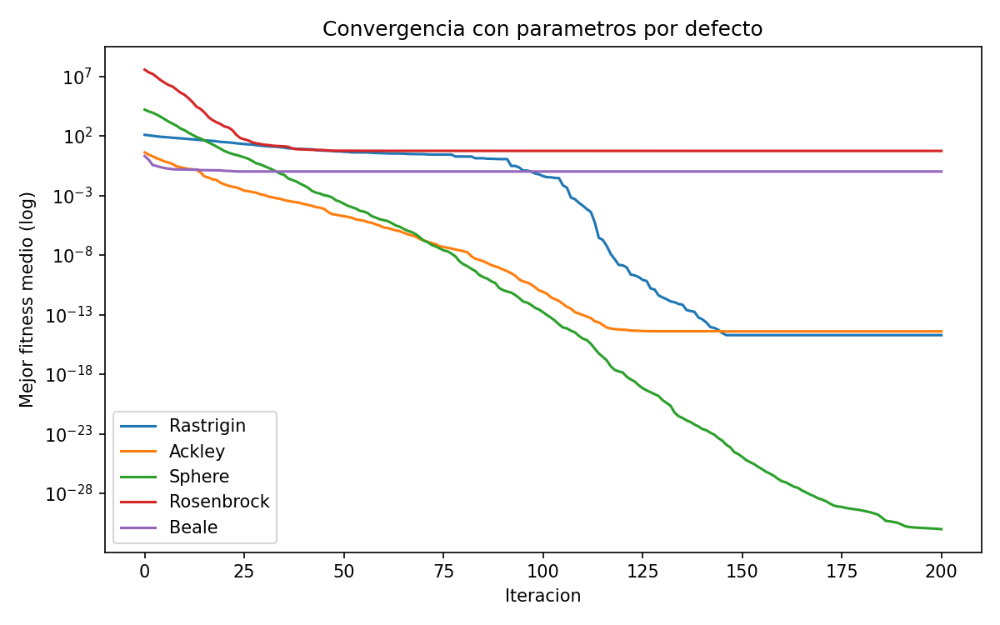

*Figura 1. Cómo fue bajando el mejor resultado en cada función (promedio de
30 corridas, escala logarítmica). Sphere baja sin parar; Rosenbrock y Beale
se quedan planas.*

**¿Qué vemos?**

- **Rastrigin, Ackley y Sphere: perfectas.** Llegan a prácticamente 0 en
  todas las corridas.
- **Rosenbrock: la más difícil.** La mayoría de las corridas se quedan en
  ~8.9, lejos de 0. En la gráfica su línea se queda plana desde la vuelta
  ~40: las ballenas se estancan (en la sección 4.4 vemos dónde y por qué).
- **Beale: casi siempre bien, a veces mal.** La mediana es casi 0, pero la
  media es 0.10. Eso pasa porque unas pocas corridas se quedan atoradas en
  **0.76** (un mínimo local) y jalan el promedio. *Ejemplo perfecto de por
  qué hay que reportar media y mediana.*
- **Rastrigin en la gráfica** se ve plana hasta la vuelta ~90 y luego cae.
  Como la gráfica es un promedio, solo baja cuando las últimas corridas
  logran salirse de los hoyitos.

### 4.2 Efecto de cada parámetro

Aquí está la parte más importante. Para cada parámetro: **qué vimos** y
**por qué pasa**.

#### Número de iteraciones (vueltas)

| Función | 50 | 100 | 200 | 500 |
|---|---|---|---|---|
| Sphere (mediana) | 4.6e-6 | 1.9e-16 | 1.8e-34 | 1.4e-89 |
| Rastrigin (peor) | 59.7 | 49.8 | 2.8e-14 | 0 |
| Rosenbrock (mediana) | 8.90 | 8.72 | 8.56 | 0.40 |

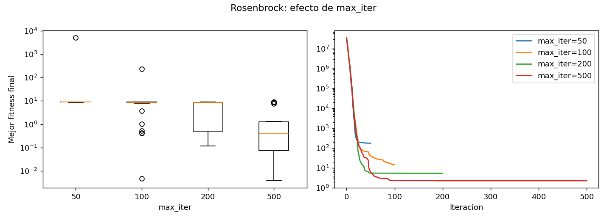

*Figura 2. Rosenbrock con distinto número de vueltas. Solo con 500 vueltas
la mayoría de las corridas logra bajar de ~8.9.*

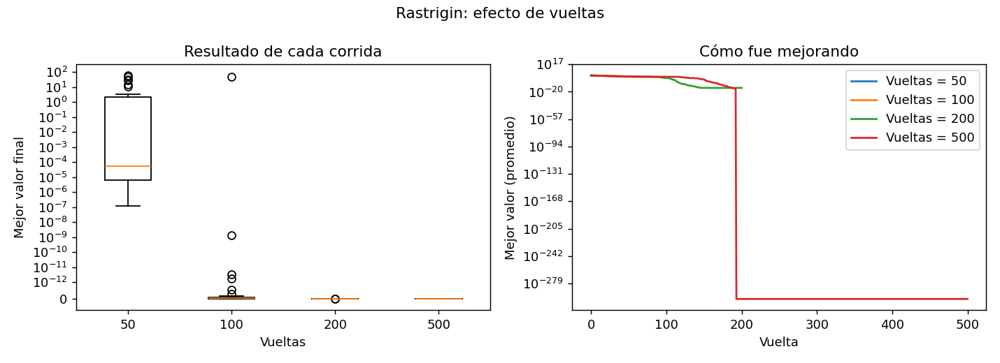

*Figura 3. Rastrigin con distinto número de vueltas. Con 50 y 100 vueltas
algunas corridas se quedan atoradas (los circulitos de arriba).*

- **Qué vimos:** es el parámetro con efecto más claro. Más vueltas = mejor
  resultado en **todas** las funciones.
- **Por qué:** `a` baja de 2 a 0 durante todas las vueltas. Con pocas
  vueltas, `a` baja de golpe: casi no hay tiempo para explorar ni para
  afinar. Con 500 vueltas, las ballenas tienen tiempo para las dos cosas.
  Rosenbrock, que se atoraba en 8.9, por fin avanza por el valle con 500.
- **El costo:** más vueltas = más tiempo de cómputo.

#### Número de ballenas

| Función | 10 | 30 | 50 | 100 |
|---|---|---|---|---|
| Rosenbrock (mediana) | 8.90 | 8.56 | 0.91 | 0.12 |
| Sphere (mediana) | 8.1e-24 | 1.8e-34 | 6.0e-39 | 7.3e-45 |
| Beale (peor) | 0.76 | 0.76 | 0.76 | 0.76 |

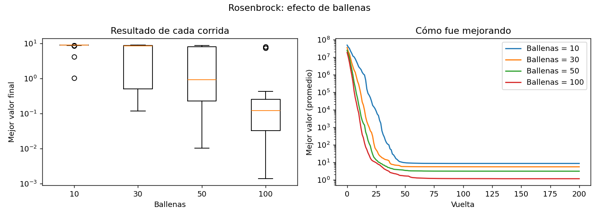

*Figura 4. Rosenbrock con distinto número de ballenas. Con 50 y 100 la
mediana baja muchísimo.*

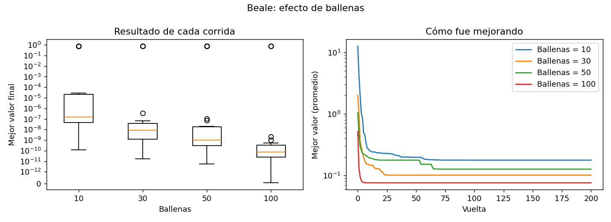

*Figura 5. Beale con distinto número de ballenas. La mediana mejora, pero
siempre hay corridas atoradas en 0.76 (los circulitos de arriba).*

- **Qué vimos:** más ballenas ayudan, sobre todo en Rosenbrock (de 8.9 a
  0.12).
- **Por qué:** con más ballenas el terreno queda mejor cubierto desde el
  inicio, y es más probable que alguna caiga cerca del mínimo bueno.
  También hay más ballenas "al azar" que sirven de referencia para explorar.
- **Pero:** en Beale, el peor caso sigue en 0.76 aunque pongamos 100
  ballenas. Esa trampa no se arregla solo con más ballenas.
- **El costo:** cada ballena extra = más evaluaciones de la función por
  vuelta.

#### `a` inicial (cuánto exploran al principio)

| Función | a = 1 | a = 2 | a = 3 |
|---|---|---|---|
| Rosenbrock (mediana) | 8.92 | 8.56 | **0.09** |
| Sphere (mediana) | **2.1e-36** | 1.8e-34 | 4.7e-26 |
| Rastrigin (peor) | **25.4** | 2.8e-14 | 2.8e-14 |

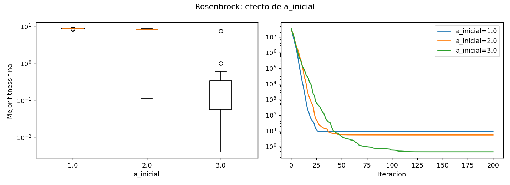

*Figura 6. Rosenbrock con distinto `a` inicial. A la derecha: con `a = 1`
baja más rápido pero se estanca; con `a = 3` baja más lento pero llega más
abajo.*

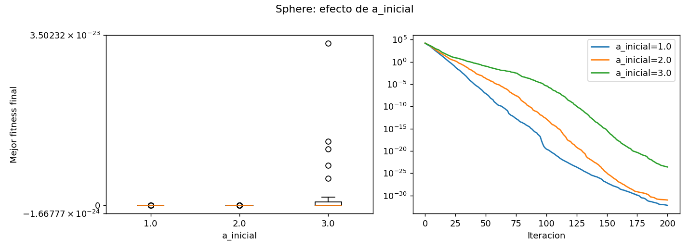

*Figura 7. Sphere con distinto `a` inicial. Aquí pasa al revés: `a = 3` es
el peor, porque gasta vueltas explorando un tazón que no tiene trampas.*

- **Qué vimos:** aquí **no hay un valor ganador**. `a = 3` es mucho mejor
  en Rosenbrock, pero peor en Sphere. `a = 1` es el mejor en Sphere, pero
  en Rastrigin algunas corridas se atoran.
- **Por qué:** es el **equilibrio explorar/explotar** de la introducción:
  - Con `a = 1`, `A` nunca pasa de 1, así que **nunca hay búsquedas al azar**:
    las ballenas solo explotan. En Sphere (un tazón sin trampas) eso es
    perfecto, pero en Rastrigin (lleno de hoyitos) algunas corridas se
    quedan atoradas.
  - Con `a = 3` exploran durante más tiempo. Eso le sirve a Rosenbrock para
    encontrar mejor el valle, pero en Sphere desperdicia vueltas que podría
    usar en afinar.
- **Dato bonito de la gráfica de Rosenbrock:** con `a = 1` la línea baja
  **más rápido** al principio, pero se queda estancada en ~9. Con `a = 3`
  baja más lento, pero llega mucho más abajo. A eso se le llama
  **convergencia prematura**: llegar rápido... al lugar equivocado.
- En la app: pestaña *Comparar*, Ackley con `a_inicial` 1 contra 3.
  Con `a = 1` nunca aparece el color naranja (buscar).

#### Umbral de `p` (rodear/buscar vs. espiral)

El umbral decide qué tan seguido se usa cada movimiento: con 0.2, el 80 % de
las veces toca espiral; con 0.8, solo el 20 %.

| Función | 0.2 | 0.5 | 0.8 |
|---|---|---|---|
| Rosenbrock (mediana) | 8.43 | 8.56 | **0.26** |
| Rastrigin (peor) | **33.1** | 2.8e-14 | 2.8e-14 |

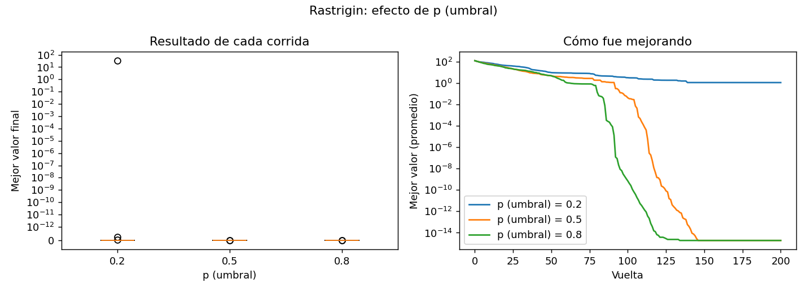

*Figura 8. Rastrigin con distinto umbral de `p`. Con 0.2 (mucha espiral)
aparecen corridas atoradas.*

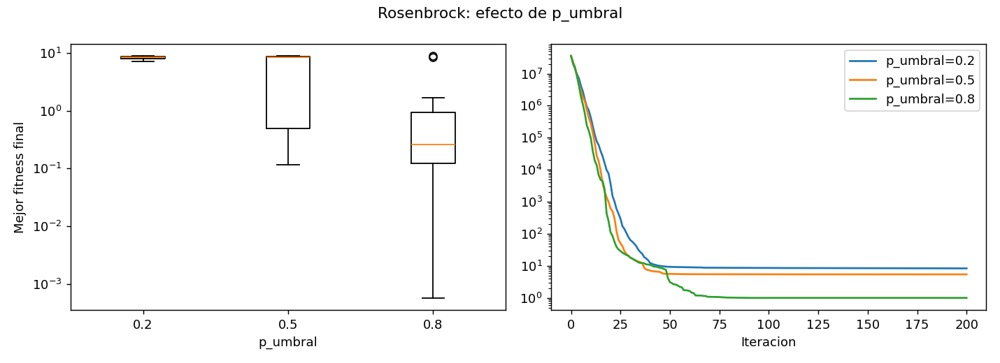

*Figura 9. Rosenbrock con distinto umbral de `p`. Con 0.8 (poca espiral) el
resultado mejora mucho.*

- **Qué vimos:** con umbral bajo (mucha espiral), Rastrigin tiene corridas
  atoradas. Con umbral alto (poca espiral), Rosenbrock mejora muchísimo.
- **Por qué:** la búsqueda al azar (la única que explora) solo puede pasar
  cuando toca "rodear o buscar". Si casi siempre toca espiral, casi no hay
  exploración y es más fácil quedarse en un hoyito. Con umbral alto hay más
  oportunidades de explorar al principio.

#### `b` (forma de la espiral)

- **Qué vimos:** casi no cambia nada. La excepción es Rosenbrock con
  `b = 2` (mediana 0.66 contra 8.56).
- **Por qué:** `b` solo cambia qué tan lejos salta la ballena en el
  movimiento de espiral. Como ese movimiento siempre es alrededor de la
  presa, no cambia mucho a dónde llegan. En Rosenbrock, saltos más largos
  ayudan a avanzar por el valle.
- **Ojo:** que un parámetro **no** tenga efecto también es un resultado
  válido y vale la pena reportarlo.

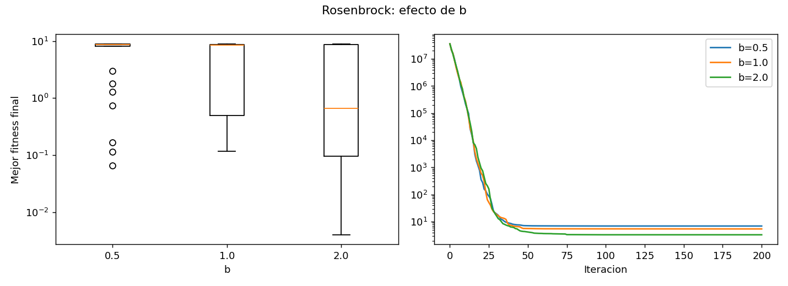

*Figura 10. Rosenbrock con distinto `b`. Es la única función donde `b`
cambia algo; en las demás las cajas quedan casi iguales (ver Anexo B).*

#### ¿Vale la pena gastar más tiempo? (tiempo de ejecución)

El profe pidió comentar el tiempo. Más ballenas o más vueltas = más
movimientos = más tiempo, casi en proporción: el doble de movimientos
tarda más o menos el doble. Con los valores por defecto (30 × 200 = 6,000
movimientos) cada corrida tarda alrededor de una décima de segundo en
nuestra computadora.

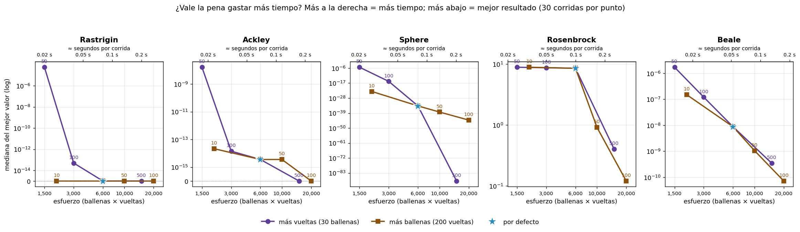

*Figura 11. Cada punto son 30 corridas. Hacia la derecha = más esfuerzo
(arriba, los segundos aproximados); hacia abajo = mejor. Morado: más
vueltas; café: más ballenas; estrella: valores por defecto.*

- **Rastrigin y Ackley:** desde los valores por defecto ya llegan
  prácticamente a 0. **Gastar más tiempo no sirve.**
- **Sphere:** sigue mejorando, pero ya estaba resuelta. Lo interesante: con
  un tiempo parecido, **más vueltas rinde mucho más que más ballenas**
  (500 vueltas da 1.4e-89; 100 ballenas, 7.3e-45).
- **Rosenbrock:** es la única donde **sí vale la pena**, y aquí conviene más
  **agregar ballenas**: con un tiempo parecido, 100 ballenas dan 0.12 y 500
  vueltas, 0.40.
- **Beale:** mejora poco a poco con cualquiera de las dos, pero la peor
  corrida se queda en 0.76 siempre: el tiempo extra no rescata a las que se
  atoran.
- *Pista del porqué:* más vueltas = más tiempo para **afinar** (lo que pide
  un tazón como Sphere). Más ballenas = más **puntos de partida**, así es
  menos probable que todas se queden en el centro (lo que pide Rosenbrock,
  sección 4.4).
- **Conclusión práctica:** los valores por defecto son un buen equilibrio.
  Solo en Rosenbrock vale la pena pagar más tiempo.

### 4.3 El experimento del mínimo movido (sesgo al centro)

Misma función, 30 corridas, solo cambia dónde está el mínimo:

| Función | Mínimo en el centro | Mínimo movido | Movido a |
|---|---|---|---|
| Sphere (10 var.) | 1.8e-34 | **2.34** | 30 en cada eje |
| Rastrigin (10 var.) | 0 | **9.84** | 2 en cada eje |
| Ackley (2 var.) | 3.6e-15 | **0.028** | 1.5 en cada eje |

*(Medianas.)* Fuente: `resultados/6_sesgo_centro/resumen.csv`

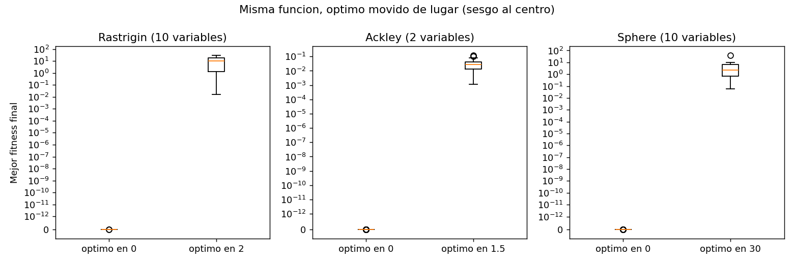

*Figura 12. La misma función con el mínimo en el centro (izquierda de cada
panel) y movido de lugar (derecha). Al moverlo, todas las corridas empeoran.*

- **Qué vimos:** la misma función, igual de difícil, da resultados muchísimo
  peores solo por mover el mínimo de lugar.
- **Por qué:** en las fórmulas de rodear y buscar aparece `C·X*` (un número
  al azar entre 0 y 2 multiplicado por la presa). Multiplicar un punto por un
  número lo acerca o aleja **del centro (0)**, así que el algoritmo tiene una
  tendencia escondida a jalar a las ballenas hacia el centro. Si el mínimo
  está ahí, ayuda muchísimo. Si no, estorba.
- **Esto explica** por qué a WOA le fue "perfecto" justo en las 3 funciones
  con el mínimo en el centro, y mal en Rosenbrock y Beale.
- **Por qué importa:** muestra que hay que tener cuidado al comparar
  algoritmos solo con funciones cuyo mínimo está en 0, porque pueden parecer
  mejores de lo que son. Otros autores han señalado este mismo problema en
  varios algoritmos.

### 4.4 ¿Por qué Rosenbrock se atora en ~8.9?

**Por el sesgo al centro.** Con 10 variables, Rosenbrock vale exactamente
**9 en el centro** (0, …, 0); su mínimo real (vale 0) está en (1, …, 1).
Revisamos **dónde** termina cada corrida:

| Ajustes (30 corridas) | Se atoran cerca del centro | Llegan al mínimo real | Mediana |
|---|---|---|---|
| Por defecto | **17** | 13 | 8.56 |
| 500 vueltas | 6 | 23 | 0.40 |
| `a = 3` | **0** | 29 | 0.092 |
| Mejor combinación (10×600, a=3, b=0.5, p=0.8) | **0** | 30 | 0.023 |

*"Cerca" = a menos de 0.5 de distancia. Fuente:
`resultados/6_sesgo_centro/rosenbrock.csv`*

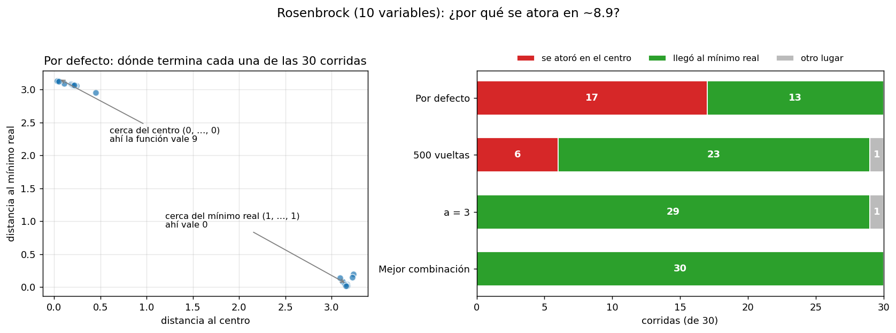

*Figura 13. Izquierda: cada punto es una corrida con los valores por
defecto; quedan en dos grupos, pegadas al centro o en el mínimo real.
Derecha: cuántas corridas se atoran en el centro con distintos ajustes.*

- **Qué vimos:** las corridas atoradas no se quedan "en cualquier parte del
  valle": **todas** terminan pegadas al centro, con valores de 8.2 a 8.9 (un
  poco menos de 9 porque no quedan justo en el 0). Por eso el "~8.9".
- **Por qué:** es el mismo jalón hacia el centro de la sección 4.3 (`C·X*`).
  En Rosenbrock el centro no es el mínimo, pero sí es un lugar
  relativamente bajo, así que las ballenas se quedan ahí y se encogen
  alrededor de él antes de encontrar el valle que lleva a (1, …, 1).
- **Por qué `a = 3` lo arregla:** explorar más tiempo les da oportunidad de
  salir del centro antes de empezar a afinar. Con más vueltas mejora pero
  no se arregla del todo (siguen 6 de 30 atoradas).
- **Para el reporte:** esto convierte la hipótesis en una explicación con
  datos, y conecta dos resultados (el sesgo al centro y Rosenbrock) en
  una sola idea.

### 4.5 ¿Nuestros números se parecen a los del artículo?

Para comparar, corrimos WOA como en el artículo: **30 variables, 30
ballenas, 500 vueltas, 30 corridas**.

| Función | Nuestra media | Artículo (aprox., **verificar en su tabla**) |
|---|---|---|
| Sphere | 3.3e-80 | ~1e-30 |
| Rosenbrock | 5.2 | ~28 |
| Rastrigin | 0 | 0 |

- **Rastrigin coincide.** En Sphere y Rosenbrock **nos sale mejor** que en
  el artículo.
- **No es un error del programa**: las pruebas confirman que cada fórmula se
  aplica bien. La explicación más probable es que el código MATLAB del autor
  no es idéntico a las ecuaciones del artículo. Por ejemplo, ese código elige
  la ballena al azar por separado para cada coordenada y usa otro rango para
  `l`. Nosotras seguimos las ecuaciones tal como están escritas.
- **Para el reporte:** es una buena observación. Muestra que pequeños
  detalles de implementación cambian los resultados y que hay que decir
  exactamente qué versión se usó.

### 4.6 ¿Qué parámetros convienen en cada función? (sección visual)

> **Cómo usar esta sección.** Son 3 figuras que responden la pregunta del
> profe sin llenar el reporte de gráficas. Abajo de cada una van los datos
> y las **pistas** del "por qué". Escriban la explicación con sus palabras;
> las pistas marcadas como *hipótesis* díganlas como hipótesis.
> En la app: pestaña *Mejor combinación*.

**Qué hicimos (para la sección 3):** movimos **varios ajustes a la vez**.
Todas las combinaciones de `a` (1, 2, 3), `b` (0.5, 1, 2) y umbral de `p`
(0.2, 0.5, 0.8), y 3 maneras de repartir **el mismo esfuerzo** entre
ballenas y vueltas: 10×600, 30×200 y 60×100 (siempre 6,000 movimientos).
Son **81 combinaciones × 25 corridas** por función. Mismo esfuerzo porque
más ballenas o más vueltas siempre ayudan (es más trabajo) y la
comparación no sería justa. Cada combinación se ordenó del lugar 1 (mejor)
al 81 por su mediana. Datos: `resultados/8_combinaciones/`.

#### Paso 1: cómo es cada terreno

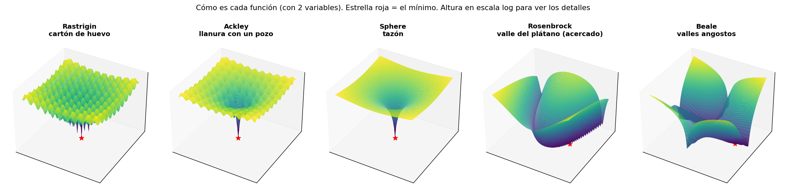

*Figura 14. Las 5 funciones con 2 variables. La forma del terreno explica
casi todo lo que viene después.*

#### Paso 2: qué valor de cada ajuste conviene en cada función

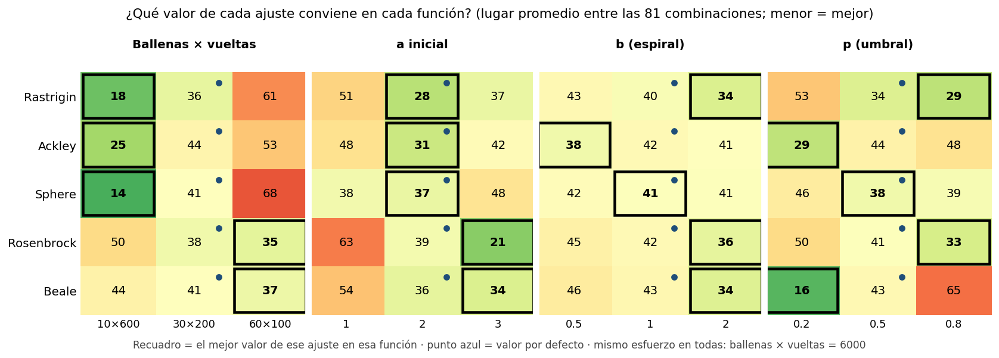

*Figura 15. Cada casilla es el lugar promedio de las combinaciones que usan
ese valor (menor = mejor). El recuadro marca el mejor valor de cada ajuste
en cada función.*

Cómo leerla: si en una fila los 3 números de un ajuste son muy distintos,
ese ajuste **importa mucho** en esa función. Si son parecidos, casi no
importa.

| Función | Mejor combinación | Su mediana | Mediana de la de por defecto (lugar) | Ajuste que más importa |
|---|---|---|---|---|
| Rastrigin | 20 empatadas (25 de 25 corridas en 0) | 0 | 0 (lugar 21) | reparto y que `a` no sea 1 |
| Ackley | 10×600, a=2, b=1, p=0.8 | 0 | 3.6e-15 (lugar 56) | reparto |
| Sphere | 10×600, a=2, b=1, p=0.5 | 7.4e-80 | 2.0e-34 (lugar 33) | reparto |
| Rosenbrock | 10×600, a=3, b=0.5, p=0.8 | **0.020** | **8.57** (lugar 47) | `a` |
| Beale | 60×100, a=3, b=2, p=0.2 | 1.7e-15 | 7.8e-9 (lugar 38) | umbral de `p` |

*(25 corridas por combinación. La de por defecto es 30×200, a=2, b=1,
p=0.5.)*

**Fichas por función** (datos + pistas del por qué):

- **Rastrigin (cartón de huevo).** Lo que más pesa es el reparto: 10×600
  queda en lugar promedio 18 y 60×100 en 61. Lo peor es `a = 1` (51) y
  `p = 0.2` (53). **Dato fuerte:** las 4 peores combinaciones de las 81
  usan **las dos cosas juntas** (`a = 1` y `p = 0.2`), con medianas de
  15 a 32.8. Por separado (sección 4.2) solo daban algunas corridas
  atoradas; juntas casi todas se atoran.
  - *Pista:* con `a = 1` nunca hay búsqueda al azar, y con `p = 0.2` casi
    siempre toca espiral. Juntas dejan a las ballenas **sin ninguna forma de
    explorar**, y en un terreno lleno de hoyitos eso es fatal. Por eso vale
    la pena probar combinaciones: hay efectos que solo aparecen juntos.
  - *Pista:* 60×100 solo da 100 vueltas; ya vimos en 4.2 que con pocas
    vueltas Rastrigin no alcanza a llegar.
- **Ackley (llanura con un pozo).** Las 81 combinaciones llegan
  prácticamente a 0 (todas sus medianas son menores que 1e-10). El
  "ganador" solo se decide por diferencias del tamaño del redondeo de la
  computadora (~1e-15).
  - *Pista:* en una función fácil para WOA (mínimo en el centro, sección
    4.3) casi cualquier ajuste sirve. Que la de por defecto quede en el
    lugar 56 **no** significa que sea mala.
- **Sphere (tazón).** Lo único que importa es el reparto: 10×600 queda en
  14 y 60×100 en 68. `b` no cambia nada (41, 41, 42). Todas llegan a
  menos de 1e-10; la diferencia está en **qué tan fino** afinan (7.4e-80
  contra 2.0e-34).
  - *Pista:* en un tazón no hay trampas, así que no hace falta explorar.
    Lo que gana es tener **muchas vueltas para seguir afinando**. Con el
    mismo esfuerzo, 10 ballenas × 600 vueltas afinan 3 veces más tiempo
    que 30 × 200.
- **Rosenbrock (valle del plátano).** Aquí sí se nota ajustar: la mediana
  baja de **8.57 a 0.020**. De sus 25 corridas, la de por defecto deja 17
  atoradas arriba de 1; la mejor, ninguna. Lo que más importa es `a`:
  `a = 3` queda en 21 y `a = 1` en 63. También ayuda `p = 0.8`.
  - *Pista:* `a = 3` y `p = 0.8` dan **más exploración** (más búsquedas al
    azar y por más tiempo). Eso les permite salir del centro, donde se
    atoran en "~8.9" (sección 4.4, ya comprobado con datos).
- **Beale (valles angostos).** Lo que más importa es el umbral de `p`, al
  revés que en Rosenbrock: `p = 0.2` (mucha espiral) queda en 16 y
  `p = 0.8` en 65. La mediana baja de 7.8e-9 a 1.7e-15.
  - *Pista:* la espiral es el movimiento que **afina alrededor de la
    presa**. En valles angostos sirve más afinar dentro del valle que
    explorar. *(Hipótesis.)*
  - **Ojo:** en la mayoría de las combinaciones (55 de 81), de 3 a 5 de
    las 25 corridas se atoran en ~0.76 (un mínimo local), y la mejor
    combinación tiene 5
    corridas atoradas, más que la de por defecto (3). **La mediana mejora,
    pero el peor caso no.** Elegir "la mejor" por la mediana o por la peor
    corrida da resultados distintos (como en 4.1 con el promedio).

#### Paso 3: ¿hay una combinación que sirva para todas?

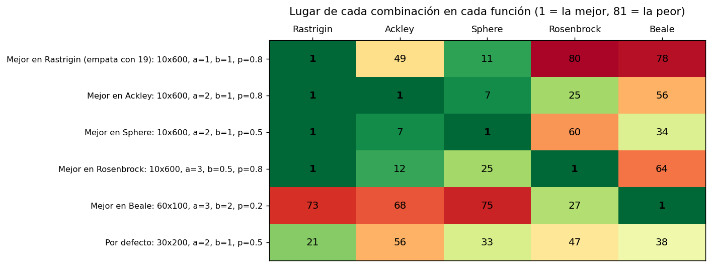

*Figura 16. Cada fila es la combinación ganadora de una función; los
números son el lugar que saca en cada función (de 81).*

- **Qué vimos:** **no**. La mejor de Beale queda en el lugar **73** en
  Rastrigin y en el 75 en Sphere. La mejor de Rastrigin queda en el
  **80** en Rosenbrock.
- **Por qué:** cada terreno pide algo distinto. Rosenbrock pide explorar
  (`a` alto, poca espiral) y Beale pide afinar (mucha espiral). Sphere solo
  pide vueltas. Lo que ayuda en un terreno estorba en otro.
- **Conexión con la teoría:** es justo la idea de que ningún método (ni
  ninguna configuración) es el mejor para todos los problemas (Wolpert y
  Macready, 1997; ver bibliografía opcional).
- **Dato para la conclusión:** la de por defecto nunca
  queda entre las 20 mejores, pero tampoco es mala en ninguna: es un
  **término medio** razonable cuando no se sabe cómo es el terreno.

### 4.7 Las 25 ejecuciones de la Tabla 1

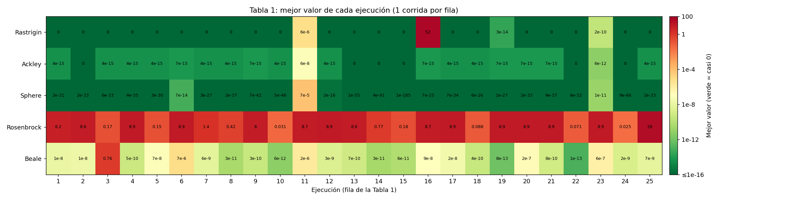

*Figura 17. El mejor valor de cada ejecución de la Tabla 1 (una corrida por
casilla). Verde = casi 0; rojo = lejos del mínimo. La tabla con los números
está en el Anexo A.8.*

**Qué se ve, función por función:**

- **Rastrigin:** 21 de 25 ejecuciones llegan a 0 exacto. Las que fallan son
  las que **casi no exploran o tienen pocas vueltas**: con `a` = 0.5
  (ejecución 16) se queda en 51.8, atorada en un hoyito, y con 50 vueltas
  (ejecución 11) en 6.1e-6. Con 30 variables (ejecución 25) también llega a
  0.
- **Ackley:** todo queda prácticamente en 0, menos las de **poco esfuerzo**:
  50 vueltas (6.3e-8) y 15 ballenas × 100 vueltas (5.7e-12).
- **Sphere:** siempre llega casi a 0; lo que cambia es qué tan fino afina, y
  depende sobre todo de las **vueltas**: 6.9e-5 con 50 vueltas, 1.3e-11 con
  la combinación ligera y 1.4e-185 con 1000 vueltas. Con 30 variables queda
  en 2.2e-33, igual de bien que con 10.
- **Rosenbrock:** es la que más varía. 14 de 25 ejecuciones se quedan arriba
  de 7.5 (en el centro, donde vale 9; ver 4.4) y solo 8 bajan de 0.5. Las
  mejores son la combinación intensiva de 60 × 400 (0.025), `b` = 2.5
  (0.071) y `a` = 3 (0.088). Con 30 variables (ejecución 25) empeora mucho:
  28.7.
- **Beale:** todas llegan casi a 0 menos la ejecución 3 (base con semilla
  2), que se atora en 0.76, su mínimo local.

**La lección más importante de esta tabla: una sola corrida engaña.** Las
ejecuciones 1 a 5 son exactamente la misma configuración y solo cambia la
semilla, y en Rosenbrock dan 6.15, 8.57, 0.17, 8.90 y 0.15: con la misma
configuración puede salir muy bien o muy mal. Por eso:

- Las conclusiones sobre cada ajuste conviene sacarlas de los barridos de 30
  corridas (secciones 4.1 a 4.6), y usar la Tabla 1 como ejemplo.
- Cuando coinciden, la Tabla 1 confirma los barridos: `a` = 3 ayuda a
  Rosenbrock (0.088 aquí; mediana 0.09 en 30 corridas) y pocas vueltas
  empeoran todas las funciones.
- Cuando la Tabla 1 trae un valor que no está en los barridos (por ejemplo
  `b` = 2.5 o 30 variables), con una sola corrida no se puede decir si fue
  el ajuste o la suerte. Para afirmarlo habría que repetirlo 30 veces.

---

## 5. Conclusiones

Ideas para escribir con sus palabras:

1. **WOA funciona**: con los valores por defecto resolvió casi
   perfecto 3 de las 5 funciones.
2. **Pero parte de ese éxito es "trampa"**: esas 3 funciones tienen el mínimo
   en el centro, y WOA tiene preferencia por el centro. Al mover el mínimo,
   el resultado empeora mucho. Fue el hallazgo más interesante del proyecto.
3. **Más vueltas y más ballenas casi siempre ayudan**, pero cuestan más
   tiempo de cómputo. Es un intercambio entre calidad y costo, y solo en
   Rosenbrock vale la pena pagarlo (Figura 11).
4. **`a` inicial y el umbral de `p` controlan el equilibrio entre explorar y
   explotar**, y **no hay un valor que sea el mejor para todas las
   funciones**: depende del tipo de terreno. Funciones con trampas
   (Rastrigin, Rosenbrock) piden más exploración; funciones sencillas
   (Sphere) prefieren afinar. Esto coincide con una idea conocida en
   optimización: ningún método o configuración es el mejor para todos los
   problemas.
5. **`b` casi no importa** en estas funciones.
6. **Reportar solo el promedio puede engañar** (caso Beale): hay que ver
   también la mediana y el peor caso.
7. **Los ajustes se combinan** (sección 4.6): `a = 1` y `p = 0.2` juntos
   arruinan Rastrigin, aunque por separado solo causaban algunas corridas
   malas. La mejor combinación de cada función es distinta, y la del
   de por defecto es un término medio que no gana en ninguna pero tampoco
   falla.
8. **Una sola corrida no basta para comparar** (Tabla 1, sección 4.7): con
   la misma configuración y otra semilla, Rosenbrock va de 0.15 a 8.90.
   Por eso las conclusiones salen de 30 corridas por valor.

**Limitaciones (es bueno decirlas):**

- Con 30 variables solo hay **una corrida** por función (ejecución 25 de la
  Tabla 1): Rosenbrock empeora y Rastrigin y Sphere no, pero habría que
  repetirlo 30 veces para asegurarlo. Todo lo demás usa 10 variables.
- La Tabla 1 usa una corrida por fila, así que sus diferencias pueden ser
  suerte (sección 4.7).
- Los dominios de Sphere y Rosenbrock los elegimos nosotras (aunque
  coinciden con los del artículo).
- Usamos 200 vueltas en lugar de las 500 del artículo.
- Las combinaciones (sección 4.6) usaron 25 corridas en lugar de 30 y solo
  un esfuerzo total (6,000 movimientos).
- Lo de Rosenbrock lo comprobamos solo con 10 variables.
- Nuestros números no son directamente comparables con los del artículo
  (sección 4.5).

**Qué se podría hacer después:** repetir las ejecuciones de la Tabla 1
con 30 corridas cada una, probar con más variables, probar las
combinaciones con otros esfuerzos, o comparar WOA contra otro algoritmo con
las funciones movidas.

---

## 6. Bibliografía

- Mirjalili, S., y Lewis, A. (2016). The Whale Optimization Algorithm.
  *Advances in Engineering Software, 95*, 51-67.
  https://doi.org/10.1016/j.advengsoft.2016.01.008
- Wikipedia. *Test functions for optimization*.
  https://en.wikipedia.org/wiki/Test_functions_for_optimization
- Mirjalili, S. *Whale Optimization Algorithm (WOA)*.
  https://seyedalimirjalili.com/woa
- Opcionales, si usan esas ideas (**verifiquen los datos antes de citar**):
  - Kudela, J. (2022). A critical problem in benchmarking and analysis of
    evolutionary computation methods. *Nature Machine Intelligence*.
    (Sobre el sesgo al centro.)
  - Wolpert, D. H., y Macready, W. G. (1997). No free lunch theorems for
    optimization. *IEEE Transactions on Evolutionary Computation, 1*(1),
    67-82. (Sobre "ningún método es el mejor para todo".)

---

## Anexo A. Todas las tablas

Los mismos datos que los CSV de `resultados/`, 30 corridas por fila
(salvo A.8, la Tabla 1, que es 1 corrida por fila).
Error = qué tan lejos quedó del mínimo real (0). En **negritas** el valor
por defecto de cada parámetro.

### A.1 Base (valores por defecto)

Fuente: `resultados/0_base/resumen.csv`

<!-- auto:anexo_base -->
| Función | Media | Mediana | Desv. est. | Mejor | Peor | Seg/corrida |
|---|---|---|---|---|---|---|
| Rastrigin | 1.89e-15 | 0 | 7.21e-15 | 0 | 2.84e-14 | 0.076 |
| Ackley | 3.91e-15 | 3.55e-15 | 2.85e-15 | 0 | 1.42e-14 | 0.066 |
| Sphere | 9.88e-32 | 1.84e-34 | 4.96e-31 | 6.14e-40 | 2.72e-30 | 0.070 |
| Rosenbrock | 5.43 | 8.56 | 3.93 | 0.117 | 8.9 | 0.083 |
| Beale | 0.102 | 8.78e-09 | 0.263 | 1.68e-11 | 0.762 | 0.047 |
<!-- /auto -->

### A.2 Rastrigin

Fuente: `resultados/1_Rastrigin/`

<!-- auto:anexo_rastrigin -->
| Parámetro | Valor | Media | Mediana | Desv. est. | Mejor | Peor |
|---|---|---|---|---|---|---|
| Número de ballenas | 10 | 9.47e-15 | 0 | 1.88e-14 | 0 | 8.53e-14 |
| Número de ballenas | **30** | 1.89e-15 | 0 | 7.21e-15 | 0 | 2.84e-14 |
| Número de ballenas | 50 | 4.74e-16 | 0 | 2.59e-15 | 0 | 1.42e-14 |
| Número de ballenas | 100 | 0 | 0 | 0 | 0 | 0 |
| Vueltas (iteraciones) | 50 | 6.76 | 5.68e-05 | 15.4 | 1.17e-07 | 59.7 |
| Vueltas (iteraciones) | 100 | 1.66 | 4.97e-14 | 9.09 | 0 | 49.8 |
| Vueltas (iteraciones) | **200** | 1.89e-15 | 0 | 7.21e-15 | 0 | 2.84e-14 |
| Vueltas (iteraciones) | 500 | 0 | 0 | 0 | 0 | 0 |
| `a` inicial | 1 | 0.983 | 0 | 4.68 | 0 | 25.4 |
| `a` inicial | **2** | 1.89e-15 | 0 | 7.21e-15 | 0 | 2.84e-14 |
| `a` inicial | 3 | 2.37e-15 | 0 | 7.54e-15 | 0 | 2.84e-14 |
| `b` (espiral) | 0.5 | 0 | 0 | 0 | 0 | 0 |
| `b` (espiral) | **1** | 1.89e-15 | 0 | 7.21e-15 | 0 | 2.84e-14 |
| `b` (espiral) | 2 | 0 | 0 | 0 | 0 | 0 |
| Umbral de `p` | 0.2 | 1.1 | 0 | 6.03 | 0 | 33.1 |
| Umbral de `p` | **0.5** | 1.89e-15 | 0 | 7.21e-15 | 0 | 2.84e-14 |
| Umbral de `p` | 0.8 | 1.89e-15 | 0 | 7.21e-15 | 0 | 2.84e-14 |
<!-- /auto -->

### A.3 Ackley

Fuente: `resultados/2_Ackley/`

<!-- auto:anexo_ackley -->
| Parámetro | Valor | Media | Mediana | Desv. est. | Mejor | Peor |
|---|---|---|---|---|---|---|
| Número de ballenas | 10 | 8.14e-14 | 2.13e-14 | 2.65e-13 | 3.55e-15 | 1.47e-12 |
| Número de ballenas | **30** | 3.91e-15 | 3.55e-15 | 2.85e-15 | 0 | 1.42e-14 |
| Número de ballenas | 50 | 2.61e-15 | 3.55e-15 | 2.46e-15 | 0 | 7.11e-15 |
| Número de ballenas | 100 | 1.54e-15 | 0 | 1.79e-15 | 0 | 3.55e-15 |
| Vueltas (iteraciones) | 50 | 1.90e-07 | 1.63e-08 | 3.94e-07 | 2.29e-10 | 1.44e-06 |
| Vueltas (iteraciones) | 100 | 1.30e-12 | 1.42e-14 | 4.63e-12 | 0 | 2.31e-11 |
| Vueltas (iteraciones) | **200** | 3.91e-15 | 3.55e-15 | 2.85e-15 | 0 | 1.42e-14 |
| Vueltas (iteraciones) | 500 | 1.30e-15 | 0 | 1.74e-15 | 0 | 3.55e-15 |
| `a` inicial | 1 | 3.43e-15 | 3.55e-15 | 4.12e-15 | 0 | 2.13e-14 |
| `a` inicial | **2** | 3.91e-15 | 3.55e-15 | 2.85e-15 | 0 | 1.42e-14 |
| `a` inicial | 3 | 5.57e-15 | 3.55e-15 | 4.24e-15 | 0 | 1.42e-14 |
| `b` (espiral) | 0.5 | 2.37e-15 | 1.78e-15 | 3.14e-15 | 0 | 1.42e-14 |
| `b` (espiral) | **1** | 3.91e-15 | 3.55e-15 | 2.85e-15 | 0 | 1.42e-14 |
| `b` (espiral) | 2 | 2.25e-15 | 1.78e-15 | 2.55e-15 | 0 | 7.11e-15 |
| Umbral de `p` | 0.2 | 2.49e-15 | 3.55e-15 | 2.66e-15 | 0 | 7.11e-15 |
| Umbral de `p` | **0.5** | 3.91e-15 | 3.55e-15 | 2.85e-15 | 0 | 1.42e-14 |
| Umbral de `p` | 0.8 | 2.84e-15 | 3.55e-15 | 2.54e-15 | 0 | 7.11e-15 |
<!-- /auto -->

### A.4 Sphere

Fuente: `resultados/3_Sphere/`

<!-- auto:anexo_sphere -->
| Parámetro | Valor | Media | Mediana | Desv. est. | Mejor | Peor |
|---|---|---|---|---|---|---|
| Número de ballenas | 10 | 6.58e-21 | 8.07e-24 | 2.71e-20 | 2.16e-31 | 1.47e-19 |
| Número de ballenas | **30** | 9.88e-32 | 1.84e-34 | 4.96e-31 | 6.14e-40 | 2.72e-30 |
| Número de ballenas | 50 | 6.78e-37 | 5.95e-39 | 2.08e-36 | 9.32e-45 | 1.01e-35 |
| Número de ballenas | 100 | 1.20e-41 | 7.33e-45 | 5.83e-41 | 2.64e-48 | 3.19e-40 |
| Vueltas (iteraciones) | 50 | 1.57e-05 | 4.63e-06 | 2.50e-05 | 2.21e-09 | 1.04e-04 |
| Vueltas (iteraciones) | 100 | 6.23e-15 | 1.89e-16 | 1.66e-14 | 2.57e-20 | 7.81e-14 |
| Vueltas (iteraciones) | **200** | 9.88e-32 | 1.84e-34 | 4.96e-31 | 6.14e-40 | 2.72e-30 |
| Vueltas (iteraciones) | 500 | 1.47e-85 | 1.42e-89 | 5.48e-85 | 1.08e-97 | 2.31e-84 |
| `a` inicial | 1 | 6.17e-33 | 2.13e-36 | 1.91e-32 | 1.30e-42 | 7.41e-32 |
| `a` inicial | **2** | 9.88e-32 | 1.84e-34 | 4.96e-31 | 6.14e-40 | 2.72e-30 |
| `a` inicial | 3 | 2.57e-24 | 4.69e-26 | 6.76e-24 | 1.56e-31 | 3.34e-23 |
| `b` (espiral) | 0.5 | 1.16e-31 | 2.83e-34 | 5.27e-31 | 2.72e-38 | 2.89e-30 |
| `b` (espiral) | **1** | 9.88e-32 | 1.84e-34 | 4.96e-31 | 6.14e-40 | 2.72e-30 |
| `b` (espiral) | 2 | 1.11e-31 | 1.43e-34 | 5.27e-31 | 2.18e-37 | 2.89e-30 |
| Umbral de `p` | 0.2 | 5.36e-26 | 7.70e-29 | 2.53e-25 | 7.31e-33 | 1.38e-24 |
| Umbral de `p` | **0.5** | 9.88e-32 | 1.84e-34 | 4.96e-31 | 6.14e-40 | 2.72e-30 |
| Umbral de `p` | 0.8 | 9.25e-32 | 9.74e-34 | 3.86e-31 | 2.44e-38 | 2.12e-30 |
<!-- /auto -->

### A.5 Rosenbrock

Fuente: `resultados/4_Rosenbrock/`

<!-- auto:anexo_rosenbrock -->
| Parámetro | Valor | Media | Mediana | Desv. est. | Mejor | Peor |
|---|---|---|---|---|---|---|
| Número de ballenas | 10 | 8.45 | 8.9 | 1.65 | 1.01 | 8.95 |
| Número de ballenas | **30** | 5.43 | 8.56 | 3.93 | 0.117 | 8.9 |
| Número de ballenas | 50 | 3.05 | 0.913 | 3.62 | 0.0101 | 8.77 |
| Número de ballenas | 100 | 1.14 | 0.12 | 2.62 | 1.37e-03 | 7.99 |
| Vueltas (iteraciones) | 50 | 177 | 8.9 | 921 | 8.63 | 5.05e+03 |
| Vueltas (iteraciones) | 100 | 14.5 | 8.72 | 40.4 | 4.75e-03 | 228 |
| Vueltas (iteraciones) | **200** | 5.43 | 8.56 | 3.93 | 0.117 | 8.9 |
| Vueltas (iteraciones) | 500 | 2.28 | 0.402 | 3.55 | 3.78e-03 | 8.89 |
| `a` inicial | 1 | 8.88 | 8.92 | 0.0942 | 8.53 | 8.95 |
| `a` inicial | **2** | 5.43 | 8.56 | 3.93 | 0.117 | 8.9 |
| `a` inicial | 3 | 0.453 | 0.0925 | 1.4 | 4.17e-03 | 7.76 |
| `b` (espiral) | 0.5 | 6.95 | 8.68 | 3.36 | 0.0666 | 8.91 |
| `b` (espiral) | **1** | 5.43 | 8.56 | 3.93 | 0.117 | 8.9 |
| `b` (espiral) | 2 | 3.3 | 0.665 | 3.97 | 4.06e-03 | 8.91 |
| Umbral de `p` | 0.2 | 8.34 | 8.43 | 0.447 | 7.24 | 8.92 |
| Umbral de `p` | **0.5** | 5.43 | 8.56 | 3.93 | 0.117 | 8.9 |
| Umbral de `p` | 0.8 | 1 | 0.259 | 2.15 | 5.72e-04 | 8.9 |
<!-- /auto -->

### A.6 Beale

Fuente: `resultados/5_Beale/`

<!-- auto:anexo_beale -->
| Parámetro | Valor | Media | Mediana | Desv. est. | Mejor | Peor |
|---|---|---|---|---|---|---|
| Número de ballenas | 10 | 0.178 | 1.50e-07 | 0.328 | 1.24e-10 | 0.762 |
| Número de ballenas | **30** | 0.102 | 8.78e-09 | 0.263 | 1.68e-11 | 0.762 |
| Número de ballenas | 50 | 0.127 | 1.05e-09 | 0.289 | 5.34e-12 | 0.762 |
| Número de ballenas | 100 | 0.0762 | 7.15e-11 | 0.233 | 6.21e-14 | 0.762 |
| Vueltas (iteraciones) | 50 | 0.153 | 1.72e-06 | 0.311 | 1.65e-10 | 0.771 |
| Vueltas (iteraciones) | 100 | 0.152 | 1.20e-07 | 0.31 | 2.24e-11 | 0.762 |
| Vueltas (iteraciones) | **200** | 0.102 | 8.78e-09 | 0.263 | 1.68e-11 | 0.762 |
| Vueltas (iteraciones) | 500 | 0.0762 | 3.49e-10 | 0.233 | 3.81e-12 | 0.762 |
| `a` inicial | 1 | 0.152 | 6.16e-07 | 0.31 | 8.49e-11 | 0.762 |
| `a` inicial | **2** | 0.102 | 8.78e-09 | 0.263 | 1.68e-11 | 0.762 |
| `a` inicial | 3 | 0.0508 | 5.02e-09 | 0.193 | 8.05e-12 | 0.762 |
| `b` (espiral) | 0.5 | 0.0762 | 8.09e-09 | 0.233 | 8.08e-13 | 0.762 |
| `b` (espiral) | **1** | 0.102 | 8.78e-09 | 0.263 | 1.68e-11 | 0.762 |
| `b` (espiral) | 2 | 0.102 | 1.13e-09 | 0.263 | 4.95e-12 | 0.762 |
| Umbral de `p` | 0.2 | 0.152 | 7.42e-13 | 0.31 | 6.88e-17 | 0.762 |
| Umbral de `p` | **0.5** | 0.102 | 8.78e-09 | 0.263 | 1.68e-11 | 0.762 |
| Umbral de `p` | 0.8 | 0.152 | 3.64e-07 | 0.31 | 1.40e-10 | 0.762 |
<!-- /auto -->

### A.7 Sesgo al centro

Fuente: `resultados/6_sesgo_centro/resumen.csv`

<!-- auto:anexo_sesgo -->
| Función | Variables | Mínimo en | Media | Mediana | Desv. est. | Mejor | Peor |
|---|---|---|---|---|---|---|---|
| Rastrigin | 10 | 0 | 1.89e-15 | 0 | 7.21e-15 | 0 | 2.84e-14 |
| Rastrigin | 10 | 2 | 11.1 | 9.84 | 9.95 | 0.0153 | 30.8 |
| Ackley | 2 | 0 | 3.91e-15 | 3.55e-15 | 2.85e-15 | 0 | 1.42e-14 |
| Ackley | 2 | 1.5 | 0.0358 | 0.0279 | 0.0329 | 1.16e-03 | 0.124 |
| Sphere | 10 | 0 | 9.88e-32 | 1.84e-34 | 4.96e-31 | 6.14e-40 | 2.72e-30 |
| Sphere | 10 | 30 | 4.88 | 2.34 | 7.7 | 0.0587 | 40.6 |
<!-- /auto -->

### A.8 Tabla 1: 25 ejecuciones por función (1 corrida cada una)

Ajustes de las funciones de n variables. \* En la ejecución 25, Rastrigin,
Sphere y Rosenbrock usan 30 variables; Ackley y Beale usan 50 ballenas, 300
vueltas, `a` = 1.5, `b` = 0.5 y `p` = 0.3. Las columnas de cada función son
el mejor valor encontrado.

<!-- auto:anexo_tabla25 -->
| # | Bloque | Ballenas | Vueltas | a | b | p | Variables | Semilla | Rastrigin | Ackley | Sphere | Rosenbrock | Beale |
|---|---|---|---|---|---|---|---|---|---|---|---|---|---|
| 1 | 1. Base y azar | 30 | 200 | 2 | 1 | 0.5 | 10 / 2 | 0 | 0 | 3.55e-15 | 1.92e-31 | 6.15 | 1.12e-08 |
| 2 | 1. Base y azar | 30 | 200 | 2 | 1 | 0.5 | 10 / 2 | 1 | 0 | 0 | 2.38e-33 | 8.57 | 1.48e-08 |
| 3 | 1. Base y azar | 30 | 200 | 2 | 1 | 0.5 | 10 / 2 | 2 | 0 | 3.55e-15 | 5.64e-33 | 0.166 | 0.762 |
| 4 | 1. Base y azar | 30 | 200 | 2 | 1 | 0.5 | 10 / 2 | 3 | 0 | 3.55e-15 | 3.51e-35 | 8.9 | 5.46e-10 |
| 5 | 1. Base y azar | 30 | 200 | 2 | 1 | 0.5 | 10 / 2 | 4 | 0 | 3.55e-15 | 2.72e-30 | 0.155 | 6.91e-08 |
| 6 | 2. Población (N) | 5 | 200 | 2 | 1 | 0.5 | 10 / 2 | 0 | 0 | 7.11e-15 | 7.48e-14 | 8.93 | 7.39e-06 |
| 7 | 2. Población (N) | 15 | 200 | 2 | 1 | 0.5 | 10 / 2 | 0 | 0 | 3.55e-15 | 3.38e-27 | 1.42 | 5.68e-09 |
| 8 | 2. Población (N) | 50 | 200 | 2 | 1 | 0.5 | 10 / 2 | 0 | 0 | 3.55e-15 | 1.90e-37 | 0.424 | 3.36e-11 |
| 9 | 2. Población (N) | 80 | 200 | 2 | 1 | 0.5 | 10 / 2 | 0 | 0 | 7.11e-15 | 6.96e-42 | 7.97 | 3.50e-10 |
| 10 | 2. Población (N) | 120 | 200 | 2 | 1 | 0.5 | 10 / 2 | 0 | 0 | 3.55e-15 | 4.63e-46 | 0.0312 | 5.93e-12 |
| 11 | 3. Iteraciones | 30 | 50 | 2 | 1 | 0.5 | 10 / 2 | 0 | 6.07e-06 | 6.32e-08 | 6.92e-05 | 8.73 | 1.54e-06 |
| 12 | 3. Iteraciones | 30 | 100 | 2 | 1 | 0.5 | 10 / 2 | 0 | 0 | 3.55e-15 | 2.43e-16 | 8.9 | 2.57e-09 |
| 13 | 3. Iteraciones | 30 | 300 | 2 | 1 | 0.5 | 10 / 2 | 0 | 0 | 0 | 1.05e-55 | 8.63 | 6.93e-10 |
| 14 | 3. Iteraciones | 30 | 500 | 2 | 1 | 0.5 | 10 / 2 | 0 | 0 | 0 | 3.94e-91 | 0.775 | 2.69e-11 |
| 15 | 3. Iteraciones | 30 | 1000 | 2 | 1 | 0.5 | 10 / 2 | 0 | 0 | 0 | 1.43e-185 | 0.183 | 6.26e-11 |
| 16 | 4. Expl. / Explot. | 30 | 200 | 0.5 | 1 | 0.5 | 10 / 2 | 0 | 51.8 | 7.11e-15 | 7.24e-25 | 8.72 | 9.46e-08 |
| 17 | 4. Expl. / Explot. | 30 | 200 | 1 | 1 | 0.5 | 10 / 2 | 0 | 0 | 3.55e-15 | 7.50e-34 | 8.93 | 2.35e-08 |
| 18 | 4. Expl. / Explot. | 30 | 200 | 3 | 1 | 0.5 | 10 / 2 | 0 | 0 | 3.55e-15 | 5.67e-26 | 0.0878 | 3.70e-10 |
| 19 | 4. Expl. / Explot. | 30 | 200 | 2 | 1 | 0.2 | 10 / 2 | 0 | 2.84e-14 | 7.11e-15 | 1.31e-27 | 8.89 | 7.86e-13 |
| 20 | 4. Expl. / Explot. | 30 | 200 | 2 | 1 | 0.8 | 10 / 2 | 0 | 0 | 7.11e-15 | 1.97e-33 | 8.9 | 1.79e-07 |
| 21 | 5. Espiral y comb. | 30 | 200 | 2 | 0.2 | 0.5 | 10 / 2 | 0 | 0 | 7.11e-15 | 8.71e-37 | 8.9 | 8.40e-10 |
| 22 | 5. Espiral y comb. | 30 | 200 | 2 | 2.5 | 0.5 | 10 / 2 | 0 | 0 | 0 | 6.09e-32 | 0.0709 | 1.00e-13 |
| 23 | 5. Espiral y comb. | 15 | 100 | 2 | 1 | 0.5 | 10 / 2 | 0 | 2.34e-10 | 5.71e-12 | 1.28e-11 | 8.92 | 6.32e-07 |
| 24 | 5. Espiral y comb. | 60 | 400 | 2.5 | 1 | 0.5 | 10 / 2 | 0 | 0 | 0 | 8.68e-66 | 0.0252 | 1.65e-09 |
| 25 | 5. Espiral y comb. | 30 | 200 | 2 | 1 | 0.5 | 30 / 2* | 0 | 0 | 3.55e-15 | 2.15e-33 | 28.7 | 6.99e-09 |
<!-- /auto -->

---

## Anexo B. Todas las gráficas en una

Las 25 gráficas de caja (5 funciones × 5 parámetros) juntas. Cada caja son
30 corridas; más abajo es mejor. La franja azul marca el valor por defecto.
Las gráficas sueltas (con la curva de cómo fue bajando) están en
`resultados/<n>_<Función>/` y en la app, *Resultados › Tablas y
descargas*.

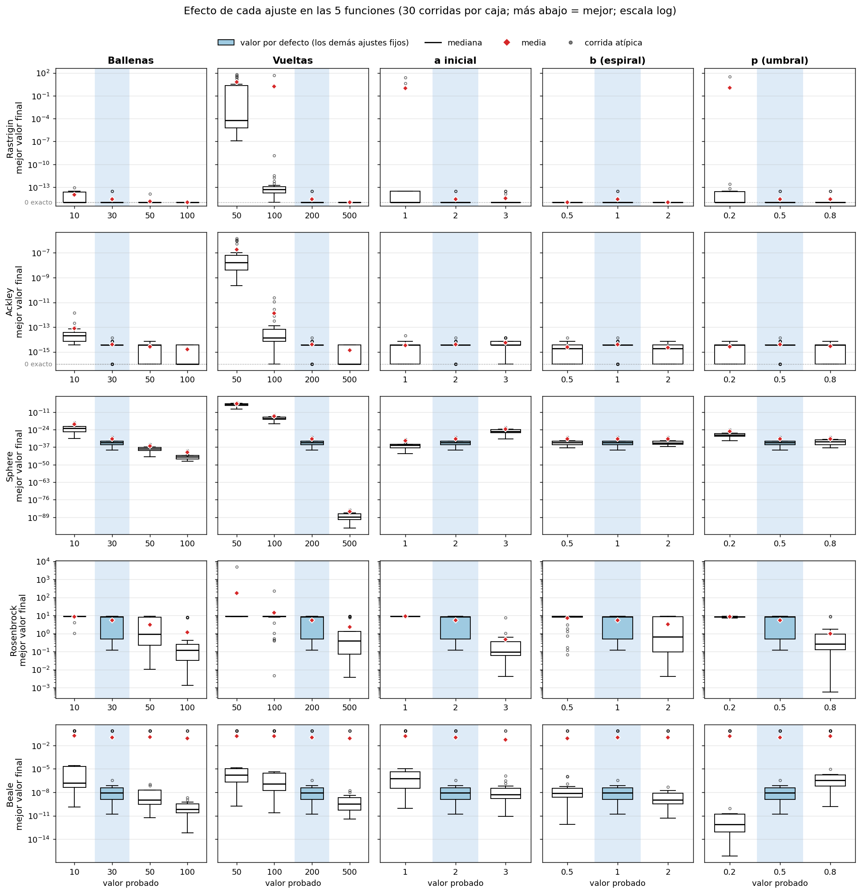

---

## Lista rápida antes de entregar

- [ ] Portada completa.
- [ ] Introducción: qué es optimizar, qué es WOA y de dónde sale.
- [ ] Desarrollo: las 3 maneras de moverse, el papel de `a`, fórmulas,
      pseudocódigo, las 5 funciones y nuestras decisiones.
- [ ] Experimentación: la Tabla 1 (25 ejecuciones por función, 1 corrida
      cada una), por qué además 30 corridas por valor, semillas y la tabla
      de valores probados en los barridos.
- [ ] Resultados de la Tabla 1 (sección 4.7, Figura 17): qué muestra y por
      qué una sola corrida no basta.
- [ ] Resultados: tabla base + gráficas, y **para cada parámetro el "por
      qué"**.
- [ ] Experimento del mínimo movido.
- [ ] Conclusiones con limitaciones.
- [ ] Bibliografía.
- [ ] Todas las figuras con número, título y una frase que diga qué se ve.
